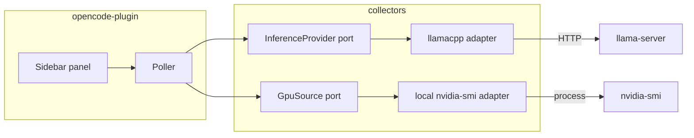

## Components

## Data flow

1. The plugin registers a `sidebar.content` slot and starts a poller (about every 1-2 s) in `setup`, stopping it in the cleanup function.
2. The poller calls `InferenceProvider.poll()` and gets a normalized sample, including the server PID when local.
3. The poller calls `GpuSource.sample(pids)`, which returns data only for the GPUs used by those processes (see ADR-0002).
4. The panel renders the latest state. Polling is asynchronous and never blocks rendering.

## Where things run

The TUI plugin runs on the OpenCode client. The `local` GPU adapter is only correct when the inference server runs on the same machine.
